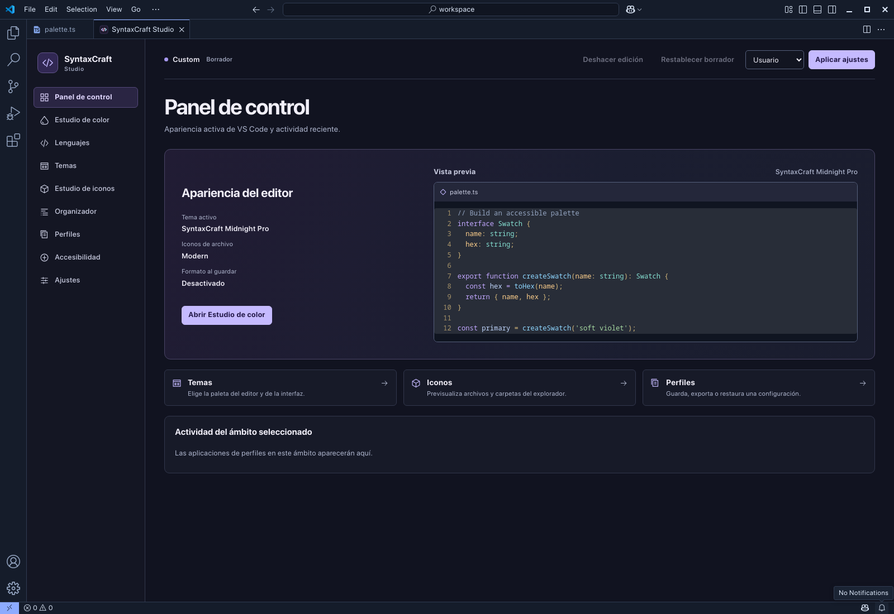
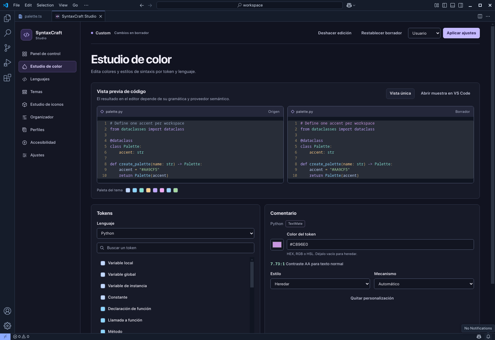
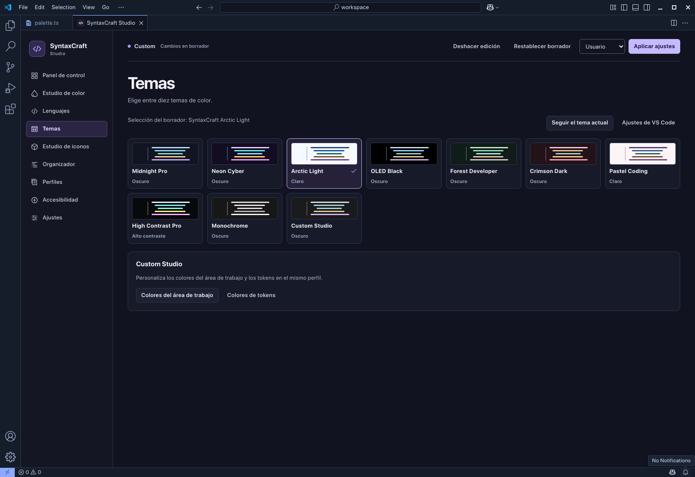
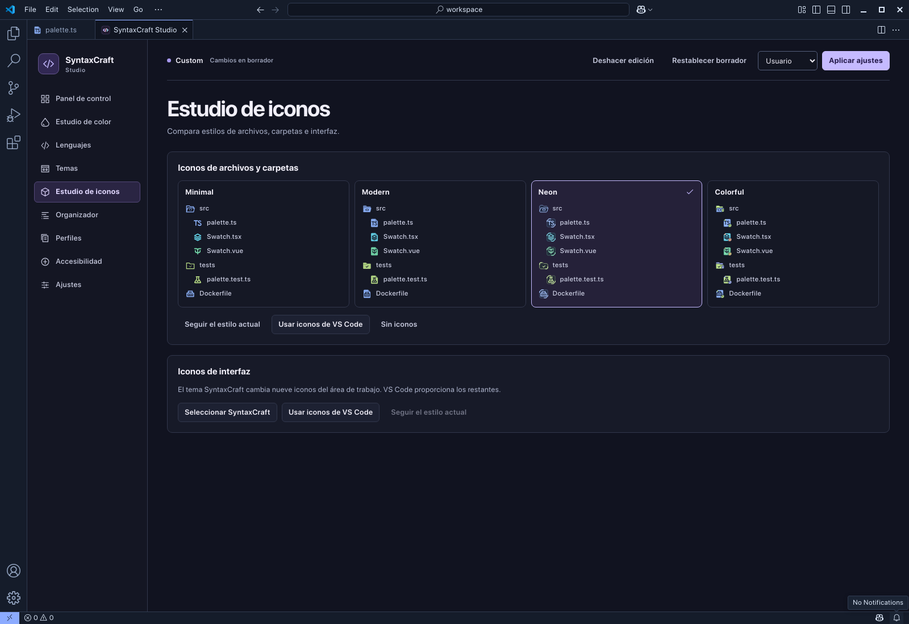
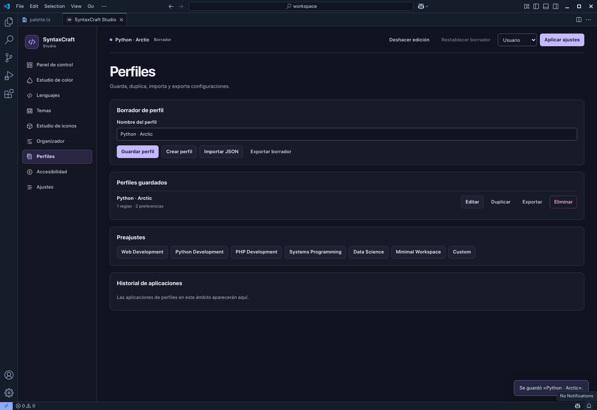
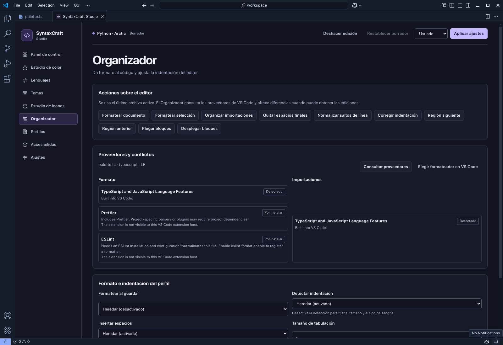

# SyntaxCraft Studio

Suite de cinco extensiones para VS Code de escritorio. Incluye temas originales, un editor visual para las reglas nativas de sintaxis, iconos del explorador, organización de código y perfiles de apariencia portátiles.

[English README](README.en.md) · [Instalación](docs/INSTALL.md) · [Desarrollo](docs/DEVELOPMENT.md) · [Publicación](docs/RELEASE.md) · [Verificación](docs/VERIFICATION.md)

## Instalar desde GitHub

[Descarga SyntaxCraft Studio 1.0.0](https://github.com/camilin7483/syntaxcraft-studio/releases/tag/v1.0.0). En **Assets**, elige el ZIP de instaladores para obtener todos los VSIX juntos o descarga los módulos que quieras usar.

1. Instala los VSIX de **Colors**, **Icons**, **Organizer** y **Control Center** con **Extensions: Install from VSIX…**. El VSIX del paquete es opcional y se instala al final si trabajas localmente.
2. Abre la paleta de comandos y ejecuta **SyntaxCraft: Open Control Center**.
3. Elige un tema, edita un token o carga un preajuste desde **Perfiles**. El borrador se previsualiza dentro del panel.
4. Selecciona **Usuario** o **Proyecto**, pulsa **Aplicar ajustes** y confirma. Guarda el borrador como perfil para recuperarlo y compartirlo después.

VS Code 1.100 o posterior. Las extensiones de interfaz incluyen todos sus recursos locales.

| Extensión      | Función                                                                                                                |
| -------------- | ---------------------------------------------------------------------------------------------------------------------- |
| Colors         | Diez temas originales y 32 categorías de color y estilo con selectores semánticos y TextMate.                          |
| Icons          | Minimal, Modern, Neon y Colorful para el explorador. Un tema de producto reemplaza nueve iconos de interfaz.           |
| Organizer      | Formato de documento o selección, importaciones, limpieza, saltos de línea, indentación y navegación por bloques.      |
| Control Center | Estudio de color e iconos, catálogo de lenguajes, accesibilidad, perfiles JSON, comparación y restauración por ámbito. |
| Extension Pack | Instala los cuatro módulos cuando estén disponibles en Visual Studio Marketplace.                                      |

## Demostración

El recorrido muestra cómo editar el color de un token de Python, comparar el resultado, elegir un tema e iconos y guardar un perfil. Al final se ven las acciones del Organizador.

SYNTAXCRAFT_DEMO_VIDEO

[Abrir el video MP4](SYNTAXCRAFT_DEMO_VIDEO)

| Panel de control                                                                                       | Estudio de color                                                                                           |
| ------------------------------------------------------------------------------------------------------ | ---------------------------------------------------------------------------------------------------------- |
|  |  |

| Temas de color                                                                             | Estudio de iconos                                                                                 |
| ------------------------------------------------------------------------------------------ | ------------------------------------------------------------------------------------------------- |
|  |  |

| Perfiles                                                                    | Organizador                                                                                  |
| --------------------------------------------------------------------------- | -------------------------------------------------------------------------------------------- |
|  |  |

## Apariencia y perfiles

Los temas incluyen Midnight Pro, Neon Cyber, Arctic Light, OLED Black, Forest Developer, Crimson Dark, Pastel Coding, High Contrast Pro, Monochrome y Custom Studio. Selecciónalos desde el panel o con **Preferences: Color Theme**. Elige un tema de iconos con **Preferences: File Icon Theme**.

En **Estudio de color** puedes buscar tokens, filtrar por lenguaje, editar HEX, RGB o HSL y comparar el origen con el borrador. **Abrir muestra en VS Code** crea un documento de ejemplo sin guardar para inspeccionar el resaltado real. **Ajustes** permite personalizar colores del área de trabajo, incluidas las superficies del editor, terminal, diagnóstico y diff. **Accesibilidad** calcula el contraste del borrador y controla fuente, altura de línea y ajuste de texto.

Los perfiles incluyen preajustes para web, Python, PHP, sistemas, datos y un espacio minimalista. Guarda, duplica y exporta los tuyos desde **Perfiles**. Para recuperar ajustes aplicados, abre **Ajustes** y selecciona **Deshacer última aplicación** o **Restaurar ajustes de Studio**. El historial conserva hasta 12 aplicaciones por ámbito y compara los cambios con los valores actuales.

## Dependencias y alcance

El registro incluye 50 entradas entre lenguajes, formatos y frameworks. La gramática o el servidor de lenguaje determina si categorías como argumento, variable global o llamada a función reciben un selector distinto. El panel muestra los mecanismos disponibles en el catálogo. Consulta los [proveedores y selectores por lenguaje](packages/colors/LANGUAGES.md).

El Organizador usa los formateadores registrados en VS Code. Consulta [la matriz de proveedores](packages/organizer/README.md) para Prettier, ESLint, Ruff, Black, PHP CS Fixer, Go, Rust y clang-format. Cuando VS Code debe resolver el formateador, su comando nativo aplica los cambios y ofrece el deshacer normal del editor. Las acciones de importación y limpieza que el módulo puede revisar muestran diferencias antes de editar.

El Control Center permite previsualizar y guardar perfiles personales en Restricted Mode. Los cambios del proyecto y las acciones del Organizador desde el panel requieren confianza. Studio guarda perfiles e historial de forma local y carece de telemetría propia.

## Desarrollo

```sh
npm ci --ignore-scripts
npm run check
npm run test:integration
npm run package
npm run verify:vsix
```

En Linux sin escritorio, ejecuta las pruebas de integración con Xvfb como indica la [guía de desarrollo](docs/DEVELOPMENT.md).

[Historial de cambios](CHANGELOG.md) · [Licencia MIT](LICENSE)
